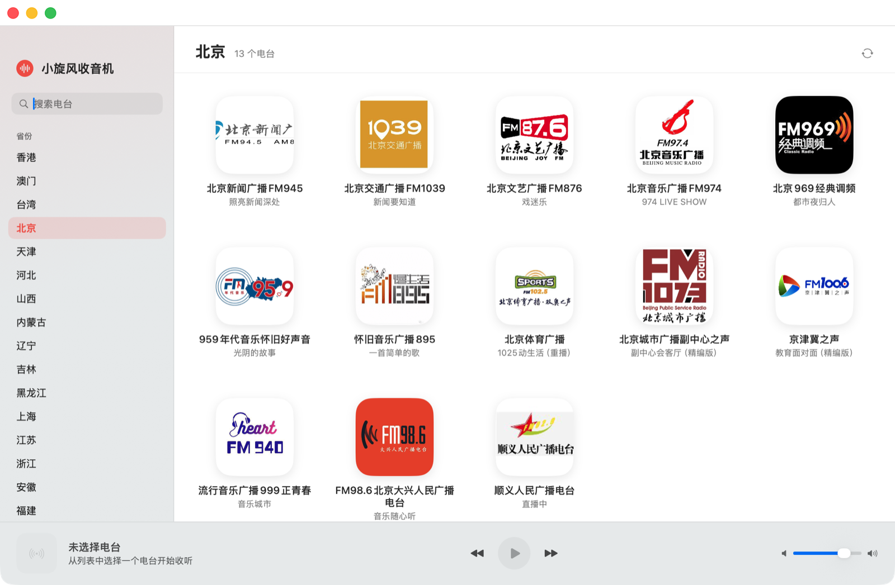

# 小旋风收音机 · 逆向 + Mac App

对 `小旋风-v1.2.5.apk`（`com.xiaoxuanfeng.ILoveRadio`，Flutter/Dart 3.10.0）的接口逆向结果，以及基于该接口实现的 macOS 原生收音机 App。

## 一、核心结论（均已实测跑通）

服务端：`http://49.232.234.212`（纯 HTTP）
所有接口：`POST`，**表单**提交单个字段 `sign`，值为 AES 加密后的 JSON。

```
请求体:  Content-Type: application/x-www-form-urlencoded
        sign=<base64(AES-128-ECB-PKCS7(json(params)))>

算法:    AES-128 / ECB / PKCS7
Key:     "ILOVERADIO666666"
IV:      "0000000000000000"（ECB 模式实际不使用）
编码:    Base64（标准）

公共参数: imei=<uuid>  uid=<uuid>  device="2"  qd="2002"
         version="1.2.5"  model="Andriod"  channelid="Andriod"

响应:    {"msg":"成功","code":"200","data":"<base64(AES(json))>"}
         data 同样是同一套 AES 加密的 JSON 字符串
```

> 之前所有接口都返回 `data:{}`，原因就是把请求体当成 JSON 发送；服务端解密失败后静默返回空 Map。正确姿势是 **form-urlencoded 的 `sign` 字段**。

### 1. 电台分类 `/radio/getAllCategory`

参数：无（只带公共参数）

```json
{
  "provinces": [{"pid": 110000, "title": "北京"}, ...],   // 34 个
  "cates":     [{"pid": 433, "title": "新闻台"}, ...],    // 14 类
  "audios":    ["相声", "财经", "英语", "戏曲"]
}
```

### 2. 电台列表 `/radio/getRadios`

参数：`provinceId`（如 `"110000"`）或 `cateId`（如 `"433"`），二选一即可。

```json
{
  "province_id": "110000",
  "cateId": "",
  "radios": [{
    "id": 3259,
    "name": "北京新闻广播FM945",
    "imgUrl": "http://imagev2.xmcdn.com/...jpg",
    "playUrl":  "https://brtv-radiolive.rbc.cn/alive/fm945.m3u8",   // 主线路
    "playUrl2": "http://ytcast.radio.cn/59/radios/20353/index.m3u8", // 备用线路
    "province_id": "110000",
    "category_id": 5,
    "playcount": 1014610,
    "desc": "暂无节目信息",
    "programme": "[{\"title\":\"照亮新闻深处\",\"start_time\":\"20:15:00\",\"end_time\":\"21:00:00\",...}]"
  }]
}
```

### 3. 播放源（刷新）`/radio/getRadio`

参数：`rid`（电台 id）
返回 `{"radio": {...}}`，结构与列表项一致。`playUrl` 中的 token 会过期，**每次播放前调一次该接口取最新地址**最稳。

### 4. 全局搜索 `/radio/getSearchRadio`

参数：`content`（关键词）→ 返回 `{"radios": [...], "audio": [...]}`。

> 其余接口（`/user/*`、`/config/*`、`/audio/*`、`/radio/getRadioBackList` 等）未在 App 中使用。

完整的字段表、真实响应样例、错误码与 Python 参考实现见 **[docs/API.md](docs/API.md)**。

## 二、Mac App



- 原生 SwiftUI + AVPlayer，无第三方依赖，双击即用。
- 左侧：省份 / 类型 分类栏 + 搜索（服务端搜索）；右侧：电台卡片网格；底部：播放控制条。
- 播放前自动调用 `/radio/getRadio` 刷新线路；主线路失败自动切 `playUrl2`。
- 卡片上显示当前节目名（解析 `programme` 字段，按北京时间匹配当前时段）。

### 构建

```bash
cd app
./build.sh          # 产出 app/build/小旋风收音机.app
./package.sh        # 再打包为 app/build/小旋风收音机-1.0.dmg
```

只依赖 Xcode Command Line Tools（`swiftc` / `iconutil` / `hdiutil`）。

`package.sh` 会生成带安装界面的 DMG：640×420 窗口、拖拽到 Applications 的引导背景、自定义卷图标，图标位置与窗口尺寸写入 `.DS_Store`。

### 项目结构

```
.
├── README.md
├── docs/
│   ├── API.md                # 完整接口文档
│   └── screenshot.png
├── api/
│   ├── client.py             # Python 参考实现（可直接跑）
│   └── categories.json       # 分类接口真实返回快照
└── app/
    ├── build.sh                  # 打包成 .app（含生成图标、ad-hoc 签名）
    ├── package.sh                # 打包成带安装界面的 DMG
    ├── scripts/makeicon.swift    # 程序化生成 App 图标
    ├── scripts/makedmgbg.swift   # 程序化生成 DMG 背景图
    ├── Resources/AppIcon.icns
    └── Sources/
        ├── ILAPI.swift           # AES + 接口封装 + 数据模型
        ├── AppModel.swift        # 状态、搜索、播放器
        ├── Views.swift           # 侧边栏 / 网格 / 播放条
        └── RadioApp.swift        # App 入口
```

> 构建产物 `app/build/`、逆向中间产物 `re/`、`blutter/`、`blutter_out/` 未纳入仓库。

## 三、逆向过程（备查）

1. APK 为 Flutter 应用，Java 层只是壳；核心逻辑在 `lib/arm64-v8a/libapp.so`（Dart AOT 快照）。
2. 用 [blutter](https://github.com/worawit/blutter) 反编译 Dart 快照，得到全部类的伪汇编：
   - 需要按快照版本 `1ce86630892e2dca9a8543fdb8ed8e22` 构建对应 Dart VM；本次用 Dart 3.10.0 源码构建并修正 `version.cc` 中的 `snapshot_hash_`。
   - 输出在 `blutter_out/`（`asm/i_love_radio/...` 即原 Dart 代码的伪汇编）。
3. 关键定位：
   - `Request/ILNetworkService.dart` → `post()`：参数拼装 + `encryptAES` + 表单提交 + `deCryptAES` 解响应。
   - `Request/ILNetworkService.dart` → `encryptAES / deCryptAES`：Key、IV、ECB/PKCS7、Base64。
   - `home_pages/logic.dart` → `_getHomeCategoryData` / `_getRadiosWithCate`：接口路径与参数名。
   - `Player/ILPlayer.dart` → `checkPlayRadio`：播放前用 `rid` 刷新播放地址。
4. 接口验证脚本见 `api/client.py`（Python 版最小实现，可直接跑）。

## 四、免责声明

仅供学习与个人使用。接口、内容与商标归原开发者所有，请勿用于商业用途或大规模抓取。
